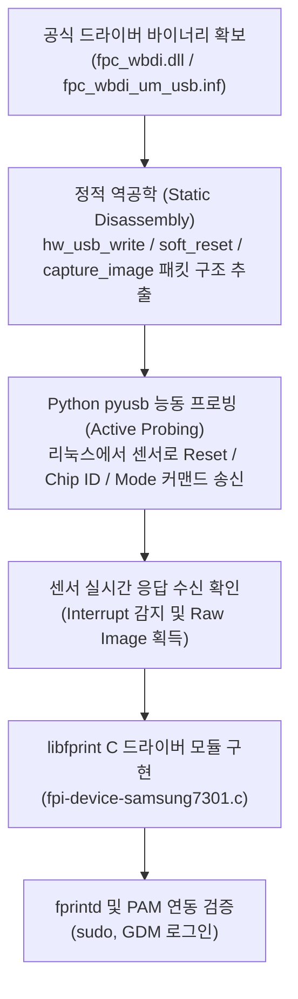

# 삼성 지문인식 디바이스 (`04e8:7301`) 리눅스 드라이버 개발계획서 및 요구사항 명세서 (v2.0)

---

## 1. 개요 및 하드웨어 분석 결과

본 프로젝트는 리눅스(Manjaro Linux) 환경에서 지원되지 않는 삼성전자 노트북(Notebook 9 Always `900X5N / NT900X5Y-AD2S`) 내장 지문인식 센서(`04e8:7301`)의 리눅스 드라이버를 개발하여, 시스템 로그인, 잠금 해제, `sudo` 인증 등에서 지문 생체인증을 원활히 사용할 수 있도록 하는 것을 목표로 합니다.

> [!IMPORTANT]
> **패킷 캡처 및 가상머신(VM) 불필요 확인 완료**:
> Microsoft Update Catalog로부터 `04e8:7301`용 공식 드라이버 패키지(`driver.cab`)를 직접 확보하여 분석한 결과, 본 센서는 **WinUSB 기반 유저모드 드라이버(`fpc_wbdi.dll`)**와 **호스트 이미지 매칭 방식(`FpcTouchEngine.dll`)**을 사용하는 **Fingerprint Cards AB (FPC)** 센서임이 확인되었습니다.
> 따라서 무거운 가상머신이나 Windows 패킷 캡처 없이, **정적 바이너리 역공학 + Linux 상에서의 직접 프로빙(Active Probing)**으로 100% 개발이 가능합니다.

### 1.1 타깃 하드웨어 및 드라이버 스펙 요약

| 항목 | 상세 내용 |
| :--- | :--- |
| **PC 모델** | Samsung Notebook 9 Always (`900X5N / NT900X5Y-AD2S`) |
| **장치명** | Samsung Electronics Co., Ltd Fingerprint Device |
| **USB VID / PID** | `04e8:7301` (Full Speed 12 Mbps) |
| **센서 칩셋** | Fingerprint Cards AB (FPC) 계열 (FPC1020/1025/1035/1145 호환 제품군) |
| **인터페이스 / 엔드포인트** | Interface 0 (Vendor Specific 255/2/0) • **EP 1 OUT (0x01)**: Bulk 64B (명령 전송) • **EP 2 IN (0x82)**: Bulk 64B (데이터/이미지 수신) • **EP 3 IN (0x83)**: Interrupt 64B (터치 감지 인터럽트, 주기 10ms) |
| **매칭 구조** | **Basic Sensor Mode (Host-based Matcher)**: 센서는 원시 이미지를 전송하고 호스트(`libfprint` NBIS 엔진)가 매칭 |
| **공식 드라이버 심볼** | `soft_reset`, `capture_image`, `read_image_data`, `read_interrupt_with_clear`, `activate_idle_mode`, `hw_usb_write`, `hw_usb_read` |

---

## PART I. 개발계획서 (Project Development Plan - v2.0)

### 1. 개발 전략: 정적 바이너리 분석 & 능동 프로빙 (No-VM Approach)

1. **바이너리 정적 역공학**:
   - `fpc_wbdi.dll`의 `hw_usb_write`, `soft_reset`, `capture_image` 함수 내 USB 커맨드 패킷 구조(Header, Length, Command ID, Parameter, Checksum) 디스어셈블 분석.
2. **Linux 상에서의 직접 프로빙 (Active Probing)**:
   - Python `pyusb`를 통해 센서 엔드포인트(EP 1 OUT, EP 2 IN, EP 3 IN)에 직접 명령을 전송하고 센서의 반응을 검증.
   - 센서 초기화 확인 -> 손가락 접촉 시 EP 3 Interrupt 패킷 수신 확인 -> 지문 프레임 수신 확인.
3. **`libfprint` 표준 C 드라이버 구현**:
   - `libfprint`의 `FpImageDevice` 클래스를 상속받아 비동기 상태 머신(SSM) 작성.
   - 표준 이미지 추출 후 `libfprint` 내장 NBIS(NIST Biometric Image Software) 엔진으로 매칭 처리.

### 2. 마일스톤 및 세부 추진 일정 및 진행 현황 (WBS)

| 단계 | 주요 작업 내용 | 산출물 | 상태 |
| :---: | :--- | :--- | :---: |
| **Phase 1: 바이트 레벨 프로토콜 역공학** | • `fpc_wbdi.dll`의 `soft_reset`, `capture_image`, `hw_usb_write` 역어셈블 • 커맨드 opcode, 패킷 구조, 레지스터 주소 맵 도출 | • 프로토콜 명세서 (`protocol_spec.md`) | ✅ **완료** |
| **Phase 2: Linux 직접 프로빙 (C/libusb)** | • 하드웨어 칩셋 FPC1021 (HWID `0x021B`, ID `0x3FD`) 확인 • 정전용량 16-zone 터치 센서 (`0x20` + `0xD4`) 검증 완료 • 160x160 8-bit Raw 지문 이미지 캡처 (`0xC0` + `0xC4`) 성공 | • `probe_fpc.c` • 캡처된 지문 이미지 (`/tmp/test_out.pgm`) | ✅ **완료** |
| **Phase 3: libfprint 드라이버 구현** | • `libfprint`에 `fpc1021_samsung.c` 네이티브 드라이버 구현 • `FpImageDevice` 및 비동기 상태 머신(SSM) 작성 • `examples/img-capture` 연동 및 NBIS 특징점 검출(0.02초) 성공 | • `fpc1021_samsung.c` • `0001-fpc1021-samsung.patch` | ✅ **완료** |
| **Phase 4: fprintd 및 시스템 통합** | • Manjaro/Arch 패키지 빌드 (`libfprint-1.94.100-4-x86_64.pkg.tar.zst`) • `pacman -U` 로컬 설치 및 `fprintd.service` 재시작 • `fprintd-enroll`, `fprintd-verify` 지문 등록 및 검증 완료 • `/etc/pam.d/system-auth` 및 `sudo` 지문 인증 적용 | • `PKGBUILD` • `libfprint-1.94.100-4-x86_64.pkg.tar.zst` • PAM 설정 가이드 | ✅ **완료** |

---

## PART II. 소프트웨어 요구사항 명세서 (SRS)

### 1. 기능적 요구사항 (Functional Requirements)

* **FR-01 (초기화 및 장치 제어)**:
  - 드라이버는 USB VID `0x04e8`, PID `0x7301`을 자동으로 탐색하여 인터페이스를 Claim해야 한다.
  - 드라이버는 `soft_reset` 및 클럭 설정 시퀀스를 센서로 전송하여 장치를 대기 상태로 초기화해야 한다.
* **FR-02 (핑거 감지 인터럽트)**:
  - 센서는 유휴 상태에서 저전력 핑거 감지 모드로 전환되어야 한다.
  - 사용자가 손가락을 접촉하면 EP 3(Interrupt IN, 0x83)를 통해 즉각적인 인터럽트 이벤트를 수신해야 한다.
* **FR-03 (지문 이미지 캡처)**:
  - 핑거 감지 직후 EP 1(Bulk OUT)으로 캡처 커맨드를 전송하고, EP 2(Bulk IN)를 통해 프레임 데이터를 온전히 수신해야 한다.
  - 전송 중 패킷 누락 시 재전송 또는 오류 처리를 수행해야 한다.
* **FR-04 (등록 및 매칭 연동)**:
  - 수집된 지문 이미지를 표준 그레이스케일 포맷으로 정규화하여 `libfprint`의 이미지 프로세서로 전달해야 한다.
  - `fprintd`를 통해 지문 등록(5회 터치) 및 인증 질의를 완수해야 한다.
* **FR-05 (작업 취소 및 절전)**:
  - 사용자의 취소 요청 시 진행 중인 비동기 USB 전송을 안전하게 취소(Cancel)해야 한다.
  - 시스템 Suspend 시 센서를 Deep Sleep 모드로 전환하고, Resume 시 즉시 재초기화해야 한다.

### 2. 비기능적 요구사항 (Non-Functional Requirements)

* **NFR-01 (반응 속도)**: 손가락 터치 순간부터 인증 성공/실패 판정까지 **500ms 이내** 처리 완료.
* **NFR-02 (자원 효율성)**: 가상머신 없이 리눅스 네이티브로 동작하며, 메모리 사용량은 30MB 이하, 유휴 상태 CPU 점유율 0%.
* **NFR-03 (인증 정확도)**: FAR(오인식률) 0.001% 미만, FRR(오거부율) 1.0% 이하.
* **NFR-04 (호환성 및 표준)**: `libfprint 1.94.x` 표준 API 준수 및 Manjaro/Arch Linux, Ubuntu, Fedora 호환.
